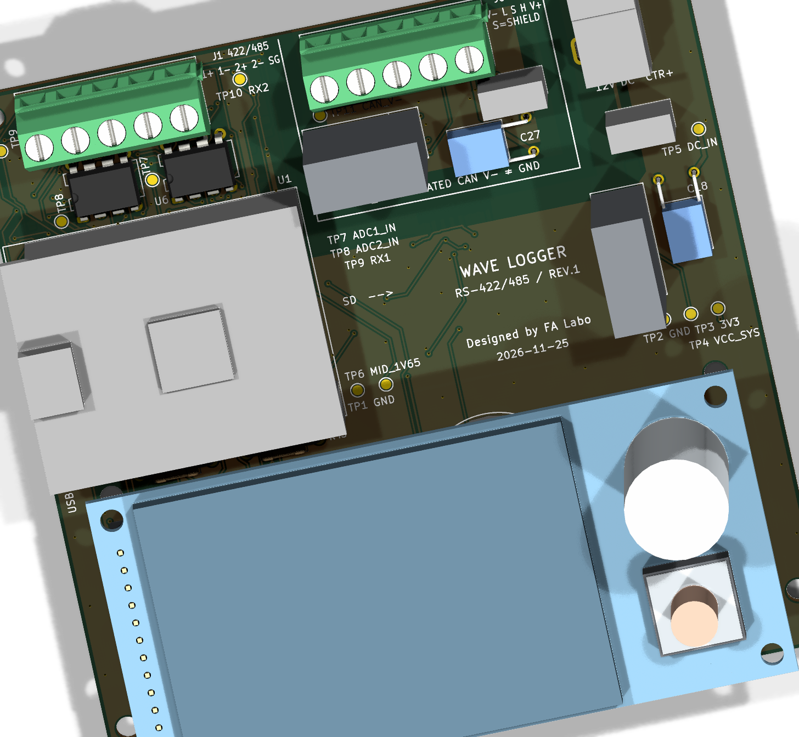
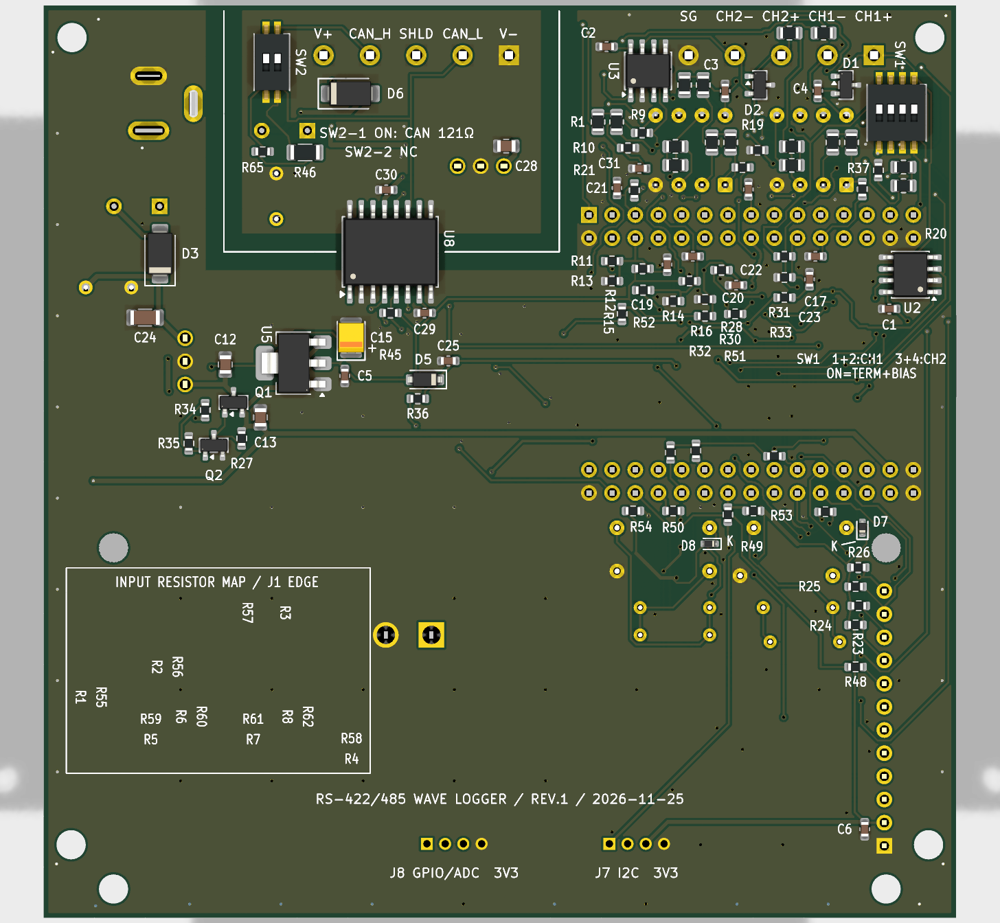
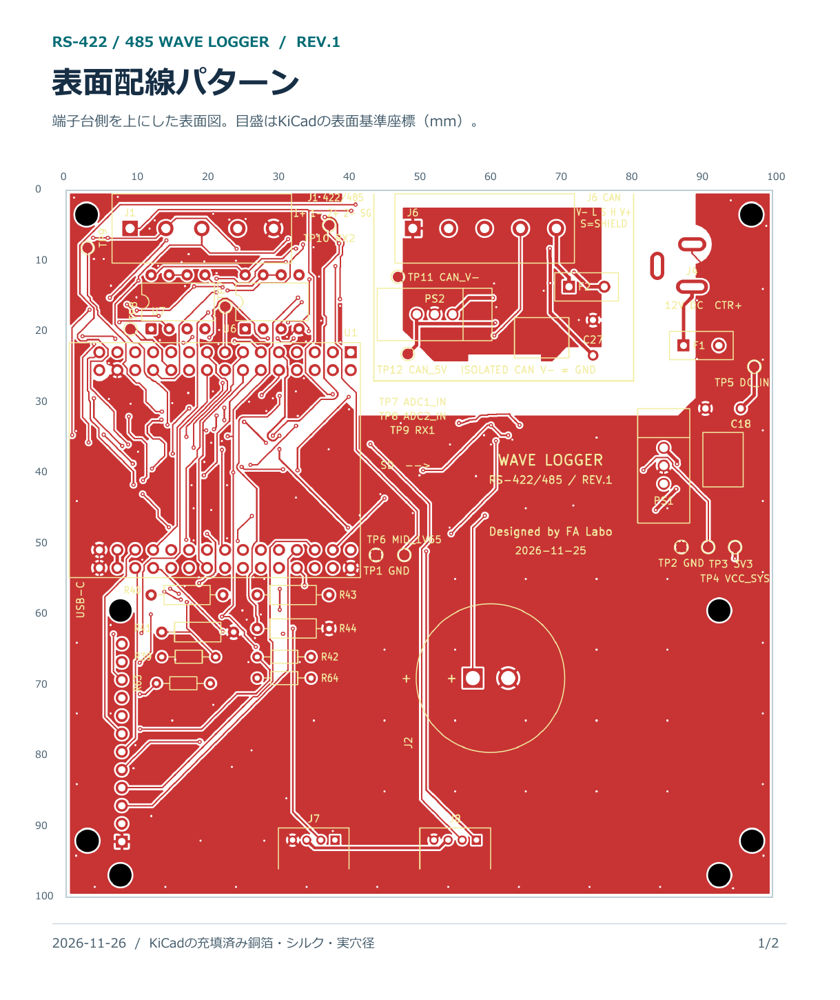
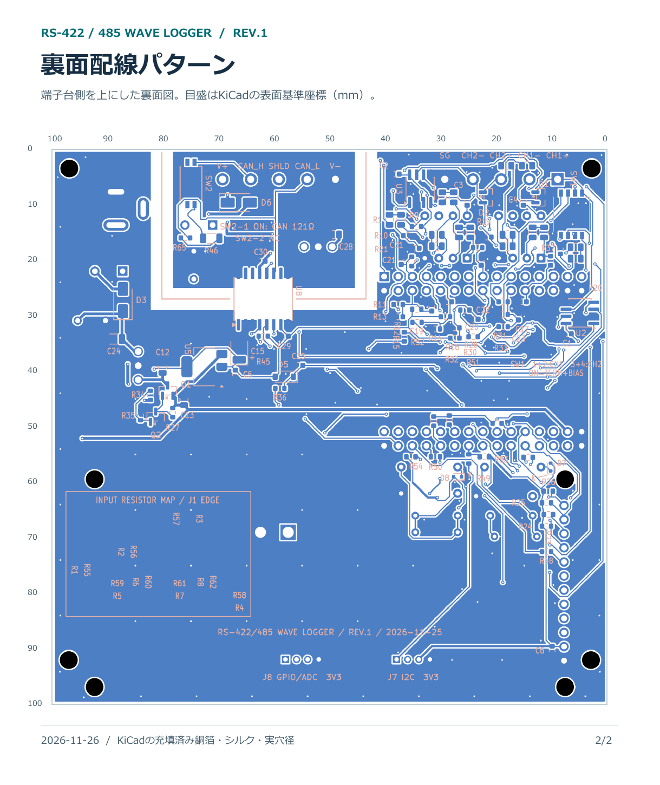
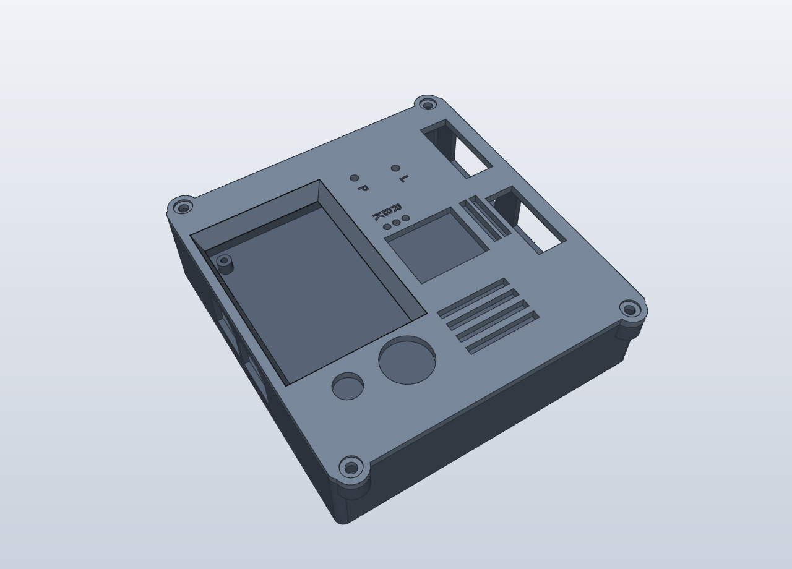

# RS-422／RS-485 波形ロガー | Rev.1

RS-422と2線・4線式RS-485の通信と差動波形、絶縁CAN（DeviceNet対応）のフレームをmicroSDに記録するロガー。通常は受信専用で、RS-485とCANの送信は切り離した試験回線で行う設計です。

## 現在の状況

Rev.1の基板と製造用データを作成済みです。DRC違反・未配線・回路図との不一致は各0件。ERCはエラー0件、警告618件。裏面74点を工場実装し、挿入部品と抵抗24点などを手はんだする構成です。波形記録の性能とケースへの実装は試作機で確認します。[入稿ファイルと確認結果](docs/Rev1-order-estimate.md#入稿ファイル)

## 接続例

[RS-422](docs/Wiring-RS422.md) ・ [RS-485（2線式・4線式）](docs/Wiring-RS485.md) ・ [Classical CAN](docs/Wiring-CAN.md) ・ [DeviceNet](docs/Wiring-DeviceNet.md)

各ガイドには受信、差動波形の測定、専用回線での試験送信の結線例があります。背面の端子台は、電線差込口を正面にして電源ジャックが左に見える向きで確認します。[端子番号と信号名の対応図](docs/wiring/Rear-Terminals.png)

端子台本体の電線差込口とねじ穴の間に信号名を合わせられる[原寸ラベル（仮合わせ用PDF）](docs/wiring/Terminal-Markers.pdf)があります。実寸で印刷して、穴の位置と表示の向きを確認できます。

## 設計・製造資料

| 目的 | 資料 |
| --- | --- |
| 手はんだ部品を用意する | [手はんだ部品表](pcb/manufacturing/Hand_Assembly_BOM.csv)（ソケットに装着するマイコンと液晶も記載） |
| JLCPCBに実装を依頼する | [JLCPCB実装部品表](pcb/manufacturing/JLCPCB-BOM.csv) |
| 回路を確認する | [回路図PDF](docs/RS422-485-Wave-Logger.pdf)・[KiCadデータ](pcb/) |
| 設計と寸法を確認する | [基板配置・取付寸法](docs/PCB-Rev1.md)・[両面の配線図PDF](docs/Rev1-copper.pdf)・[ケース組立](enclosure/drawings/Assembly.md) |
| 基板を製造・実装する | [入稿ファイルと発注条件](docs/Rev1-order-estimate.md#入稿ファイル)・[手はんだ実装図](enclosure/drawings/Hand-Solder-Assembly-Rev1.pdf) |
| 検証結果を確認する | [現行Rev.1の製造性検証](docs/verification/Rev1-DFM.md#2026-11-25-発注用データ)・[検証レポート一覧](docs/verification/) |

## 基板の外観

| 表面（操作側）の実装3D図 | 裏面（工場実装側）の実装3D図 |
| --- | --- |
|  |  |

| 表面の配線（F.Cu） | 裏面の配線（B.Cu） |
| --- | --- |
|  |  |

## 主な仕様

| 項目 | 内容 |
| --- | --- |
| RS-422／485 | 2ペアを受信し、差動波形と同相電圧を監視。差動波形は各2 MS/sが設計目標。通常測定時は裏面のSW1を全極OFF |
| CAN | 絶縁Classical CAN、DeviceNet対応。CAN側電源はJ6のV+／V−から供給。通常測定時はSW2の終端をOFF |
| 記録と操作 | microSD、12ピン液晶、ロータリーエンコーダー |
| 基板 | 100 × 100 mm、2層、板厚1.6 mm |
| 拡張端子 | Grove 2口（J7 I²C、J8 GPIO／ADC、各3.3 V） |
| ケース | 3Dプリント用。幅121.1 × 奥行110 × 高さ30.4 mm（樹脂ケース単体） |

**測定中はUSBでPCに接続しない。** 電源はDC出力が接地されていない安定化12 V・1 AのACアダプター（外径5.5 mm、内径2.1 mm、センタープラス）を使用します。ログは測定後にmicroSDを取り出して読み込みます。USBで設定・書き込みする前に、測定対象とACアダプターを外します。[対応アダプターの例](https://akizukidenshi.com/catalog/g/g117429/)

## 主な部品と選定理由

- **WeAct STM32H562RGT6**。差動波形2チャンネルの取り込み、通信の受信、基板上のmicroSDへの記録を1枚で受け持ちます。
- **SP3485とMCP6022**。SP3485で各ペアのデジタル信号を受信し、MCP6022と精密抵抗で差動波形をADCの入力範囲に収めます。
- **ADM3054**。CANの送受信を本体の回路から絶縁します。

## 3Dプリント用ケース

ふたはM3の熱圧入インサートとM3×6 mmねじ各4個で固定します。組立手順で、液晶の支持部品、背面端子の結線順、底面のDIPスイッチの向きを確認できます。

[ケース3D（GitHubブラウザー表示）](enclosure/3d-models/Case_Browser.stl)・[ケースSTEP](enclosure/3d-models/Wave-Logger-Case.step)・[編集用SolidCraftモデル](enclosure/3d-models/Wave-Logger-Case.sc)・[底STL](enclosure/print/Wave-Logger-Tray.stl)・[ふたSTL](enclosure/print/Wave-Logger-Lid.stl)・[組立手順とスイッチ・LEDの位置](enclosure/drawings/Assembly.md)・[基板を含む組立STEP](enclosure/3d-models/Wave-Logger-Assembly.step)

## ライセンス

本プロジェクトのオリジナルのハードウェア設計を **CERN Open Hardware Licence Version 2 – Weakly Reciprocal（`CERN-OHL-W-2.0`）** で公開します。[ライセンス全文](LICENSE)

対象は、KiCadの回路図・基板・プロジェクトとプロジェクト独自のライブラリ、編集用ケースモデル、独自の部品モデル、およびこれらに対応する製造・組立データのうち本プロジェクトが権利を持つ部分です。編集用ソースと製造・組立に必要な情報は、このリポジトリの [KiCadデータ](pcb/)・[ケースデータ](enclosure/)・[製造資料](docs/Rev1-order-estimate.md) にあります。[Source Location](https://github.com/fa-yoshinobu/RS422-485-Wave-Logger-HW)

第三者のデータには各権利者の利用条件が適用されます。KiCad標準ライブラリにはKiCadのライセンスが適用されます。[KiCadライブラリのライセンス](https://www.kicad.org/libraries/license/)
