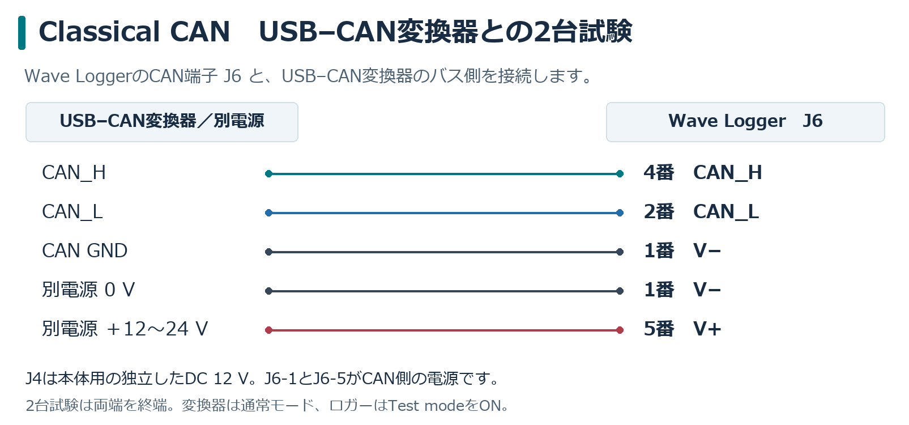
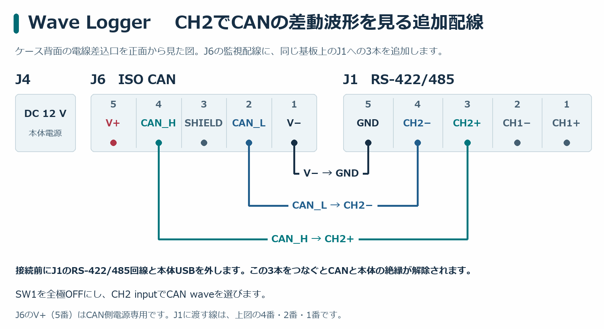

# Wave LoggerのClassical CAN接続例

## 既設回線の通信を読む

バスのCAN_HをJ6-4、CAN_LをJ6-2、バス側の信号基準をJ6-1（V−）へ分岐します。J6-5（V+）とJ6-1にはCAN側専用のDC 12～24 Vを供給します。本体は出力が接地されていないDC 12 VアダプターをJ4に接続して給電し、ロガーのUSBは外します。

途中から観測するときはSW2-1（121 Ω終端）と `Hardware > Test line (TX) > Test mode` をOFFにします。`Hardware > CAN > Bit rate` を回線に合わせると、CAN画面でID・データ長・データを確認できます。通常の絶縁監視ではJ1への追加配線は不要です。

## USB–CAN変換器と2台で送受信する

1. 専用の試験回線で図のように配線し、両端の終端を有効にします（ロガーはSW2-1をON）。両方をClassical CANの同じ速度、例えば500 kbit/sに合わせます。
2. 変換器を通常モードにし、ロガーの `Test mode` をONにします。PCから送るとロガーがACKを返し、受信フレームをCAN画面に表示します。
3. 逆方向はロガーの `Hardware > CAN > Test frame ID` でIDを選び、`Hardware > Test line (TX) > Send CAN frame` を実行します。データは `TEST` の4文字と4バイトのカウンターです。変換器側で受信を確認します。

## CAN_HとCAN_Lの差動波形を見る

J1からRS-422/485の全配線を外し、ロガー本体のUSBを抜きます。J6に接続したCAN_H・CAN_L・V−を、下図のとおりJ1のCH2+・CH2−・GNDに分岐します。3本をつないでいる間は、CAN回線と本体は非絶縁です。

SW1を全極OFFにして `Hardware > CAN > CH2 input` を `CAN wave` にします。`Display > Wave span` を `ADC snapshot` に設定し、通信中に `Hardware > Waveform > Capture now` で取り込むと、Wave画面のCH2に **CAN_H − CAN_L** が出ます。各線のV−に対する電圧を低速で確認するにはLines画面を使います。

[ケース背面の端子配置](wiring/Rear-Terminals.png)・[回路図PDF](RS422-485-Wave-Logger.pdf)・[CANの配線と絶縁境界](../pcb/DC_Power.kicad_sch)
