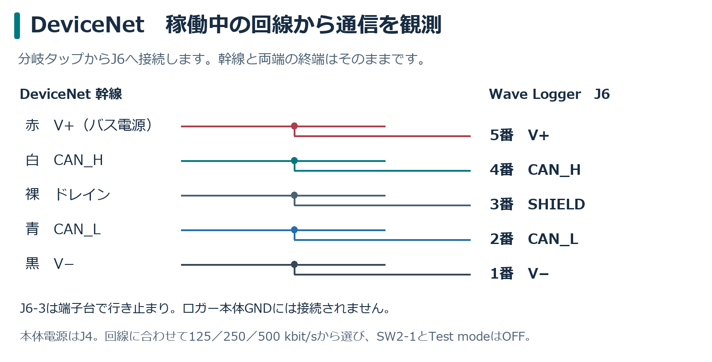
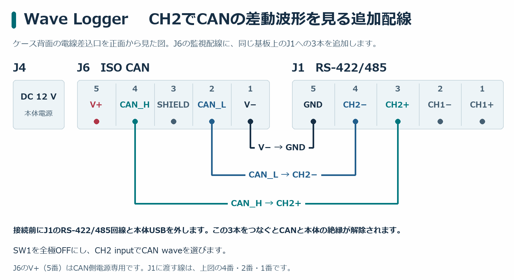

# Wave LoggerのDeviceNet接続例

## 稼働中のネットワークを観測する

既設の分岐タップから絶縁CAN端子J6へ引き込みます。CAN側はDeviceNetのバス電源、本体はJ4に接続した出力非接地のDC 12 Vアダプターで給電し、ロガーのUSBは外します。下図は丸ケーブルの線色です。

バスの既設終端を維持し、ロガーのSW2-1（終端）と `Hardware > Test line (TX) > Test mode` はOFFにします。`Hardware > CAN > Bit rate` を現場の **125・250・500 kbit/s** のいずれかに合わせます。CAN画面とmicroSDで確認できる内容はCAN ID・データ長・データです。CIPサービス名や機器のI/O割り付けの自動解釈には対応していません。

## 回線の差動波形を見る

J1のRS-422/485配線とロガーのUSBを外したうえで、**白のCAN_HをJ1-3（CH2+）、青のCAN_LをJ1-4（CH2−）、黒のV−をJ1-5（GND）** にも接続します。赤のV+はJ6-5だけに入れます。J1へ分岐している間はDeviceNetとロガー本体が非絶縁になります。

SW1を全極OFFにして `Hardware > CAN > CH2 input` を `CAN wave`、`Display > Wave span` を `ADC snapshot` に設定します。通信中に `Hardware > Waveform > Capture now` で取り込むと、Wave画面のCH2に **CAN_H − CAN_L** が出ます。通常の絶縁監視に戻すときは、追加した3本をすべて外します。

## 試験送信で確認できること

生産ネットワークから切り離した卓上回線では、ロガーとACKを返す対向機を同じ速度にして、`Test mode` をONにするとJ6から標準CANの試験フレームを送れます。これは物理配線とCAN送受信の確認用です。DeviceNetのスキャンやI/O通信の開始にはDeviceNetスキャナを使用します。[試験送信の結線・操作](Wiring-CAN.md)

[ケース背面の端子配置](wiring/Rear-Terminals.png)・[回路図PDF](RS422-485-Wave-Logger.pdf)・[DeviceNetのケーブルと線色](https://literature.rockwellautomation.com/idc/groups/literature/documents/um/dnet-um072_-en-p.pdf)
