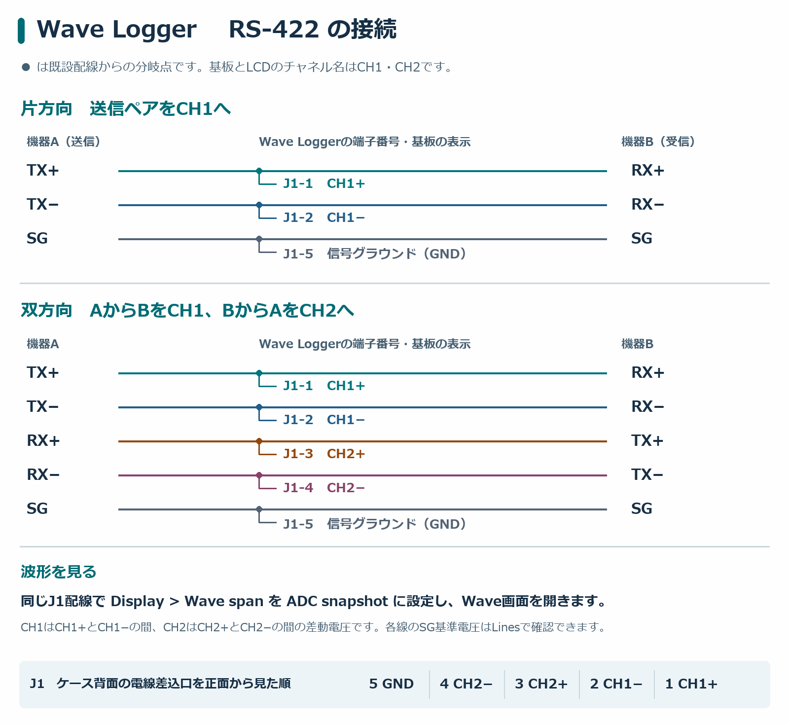
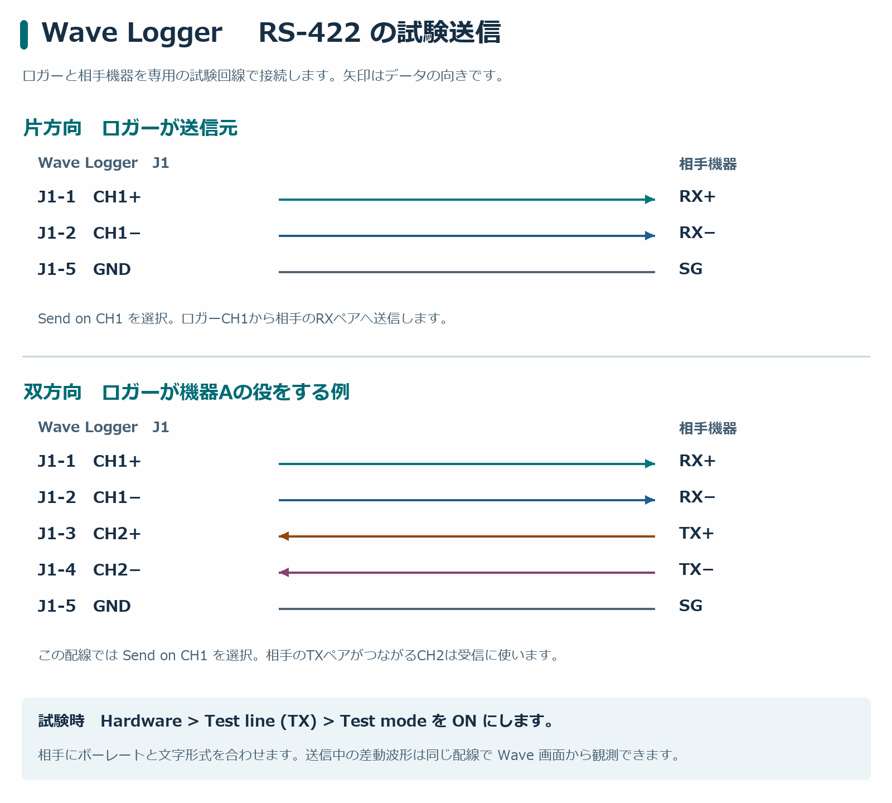

# Wave Logger Rev.1 の RS-422 配線

## 片方向と双方向の接続

機器間の既存配線から、信号ペアとSG（信号グラウンド）をケース背面の `RS-422/485` 端子台J1へ並列に分岐します。TXは各機器からの送信、RXはその機器への受信を表します。配線図・基板・LCDのチャネル名は `CH1`・`CH2` です。

- **片方向**　機器AのTX+をCH1＋（J1-1）、TX−をCH1−（J1-2）、SGをJ1-5（GND）へ。CH1で機器AからBへの送信を観測します。
- **双方向**　上の配線に加え、機器BのTX+をCH2＋（J1-3）、TX−をCH2−（J1-4）へ。機器BからAへの送信をCH2で観測します。

機器にA/Bだけが印刷されている場合は、各機器の説明書で＋線と−線の対応を確認してください。ケース背面で電線差込口を正面から見ると、J1は左から `5 GND ｜ 4 CH2− ｜ 3 CH2+ ｜ 2 CH1− ｜ 1 CH1+` の順です。個別のピン名は基板裏に印刷しています。[差込口から見た端子の図](wiring/Rear-Terminals.png)・[ケース背面の端子配列](../enclosure/drawings/Assembly.md)・[基板の端子表示](PCB-Rev1.md)

既設回線の途中での観測はSW1を全極OFF、`Test mode` をOFFにします。J1-5は本体GNDと共通です。測定中は本体USBを外し、J4に出力が接地されていない安定化DC 12 V・1 Aのアダプターを接続します。[電源仕様](../README.md)・[入力回路図](../pcb/Inputs.kicad_sch)

## 差動電圧の波形を見る

通信と波形は同じJ1配線で観測できます。`Display > Wave span` で `ADC snapshot` を選び、`Wave` 画面を開きます。片方向の場合はCH1、双方向の場合はCH1で往路、CH2で復路の差動電圧を読みます。＋線と−線それぞれのSG基準の電圧は `Lines` 画面で確認できます。

## 試験回線でロガーから送信する

ロガーを送信元として使う例です。稼働中の回線から切り離し、相手のRXペアをロガーのCH1に接続します。双方向で応答も見る場合は、相手のTXペアをCH2に接続します。

1. 受信端の終端は相手機器の仕様に合わせます。ロガーの端に120 Ω終端とバイアスの両方が必要なペアだけ、CH1はSW1の1・2、CH2は3・4を対でONにします。既設の終端・バイアスと重複させないよう確認してください。[スイッチと回路](../pcb/Inputs.kicad_sch)
2. `Hardware > Test line (TX) > Test mode` をONにし、ボーレート、文字形式、送信パターンを選びます。図では `Send on CH1` で相手のRXペアへ送信します。相手がTXペアを駆動している間、CH2は受信に使います。
3. CH1・CH2はどちらも送信可能です。相手のRXペアをCH2側に配線する構成では、`CH2 input` を `RS-485` に設定し、`Send on CH2` を選びます。試験後は `Test mode` をOFFにします。
