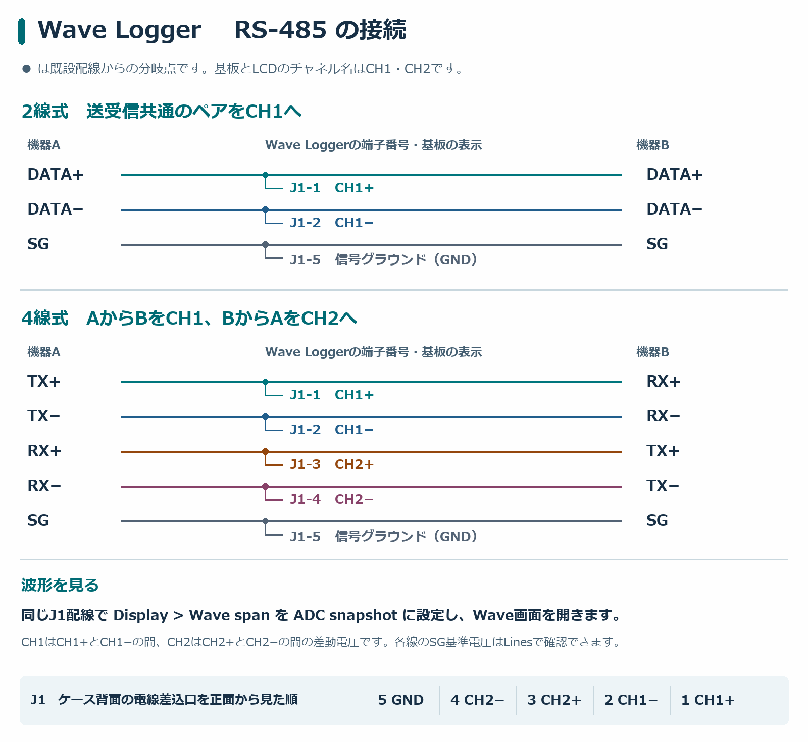
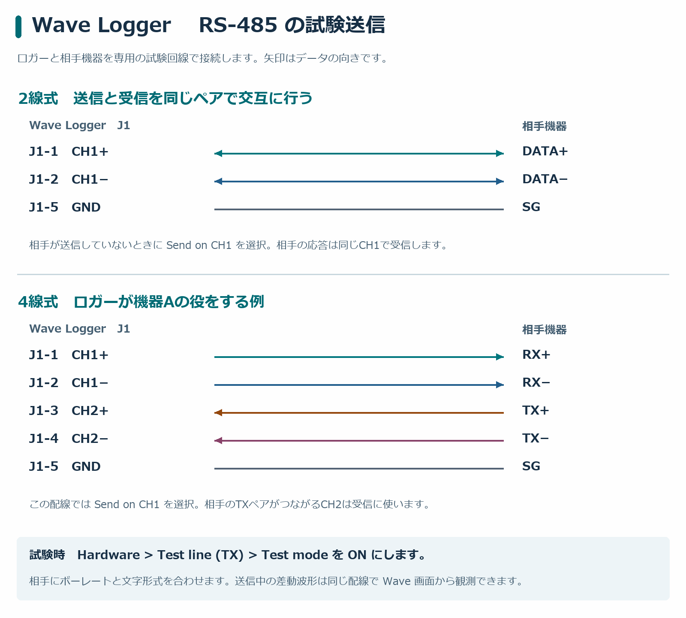

# Wave Logger Rev.1 の RS-485 配線

## 2線式と4線式の接続

機器間の既存配線から、信号ペアとSG（信号グラウンド）をケース背面の `RS-422/485` 端子台J1へ並列に分岐します。配線図・基板・LCDのチャネル名は `CH1`・`CH2` です。

- **2線式**　送受信共通のDATA+をCH1＋（J1-1）、DATA−をCH1−（J1-2）、SGをJ1-5（GND）へ。両方向の通信が同じCH1に現れます。
- **4線式**　各機器のTXが送信、RXが受信です。機器AのTX+／TX−をCH1＋／CH1−（J1-1／J1-2）、機器BのTX+／TX−をCH2＋／CH2−（J1-3／J1-4）、SGをJ1-5（GND）へ分岐します。

DATA+／DATA−の表記は機器によって異なります。A/B表記の機器は説明書で極性を確認してください。ケース背面で電線差込口を正面から見ると、J1は左から `5 GND ｜ 4 CH2− ｜ 3 CH2+ ｜ 2 CH1− ｜ 1 CH1+` の順です。個別のピン名は基板裏に印刷しています。[差込口から見た端子の図](wiring/Rear-Terminals.png)・[ケース背面の端子配列](../enclosure/drawings/Assembly.md)・[基板の端子表示](PCB-Rev1.md)

既設回線の途中での観測はSW1を全極OFF、`Test mode` をOFFにします。J1-5は本体GNDと共通です。測定中は本体USBを外し、J4に出力が接地されていない安定化DC 12 V・1 Aのアダプターを接続します。[電源仕様](../README.md)・[入力回路図](../pcb/Inputs.kicad_sch)

## 差動電圧の波形を見る

通信と波形は同じJ1配線で観測できます。`Display > Wave span` で `ADC snapshot` を選び、`Wave` 画面を開きます。2線式ではCH1でDATA+とDATA−間の電圧を読みます。4線式ではCH1とCH2を同時に表示し、往路と復路の振幅を比較できます。＋線と−線それぞれのSG基準の電圧は `Lines` 画面で確認できます。

## 試験回線でロガーから送信する

稼働中の回線から切り離し、相手機器とロガーを下図のように接続します。2線式では相手が送信を終えてから同じペアを使います。4線式では相手のRXペアをCH1、相手のTXペアをCH2に割り当てて、送信と受信を分けられます。

1. 試験回線の末端でロガーに120 Ω終端とバイアスの両方を持たせる場合だけ、CH1はSW1の1・2、CH2は3・4を対でONにします。既設の終端・バイアスと重複させないよう確認してください。[スイッチと回路](../pcb/Inputs.kicad_sch)
2. `Hardware > Test line (TX) > Test mode` をONにし、相手にボーレートと文字形式を合わせ、送信パターンを選びます。図ではどちらも `Send on CH1` で送信します。4線式のCH2は相手からの応答を受けます。
3. CH1・CH2はどちらも送信可能です。送信に使うペアをCH2に配線した構成では、`CH2 input` を `RS-485` に設定し、`Send on CH2` を選びます。相手が駆動中のペアには送信しません。試験後は `Test mode` をOFFにします。
