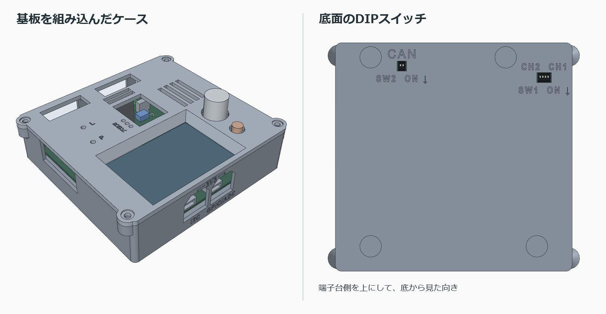
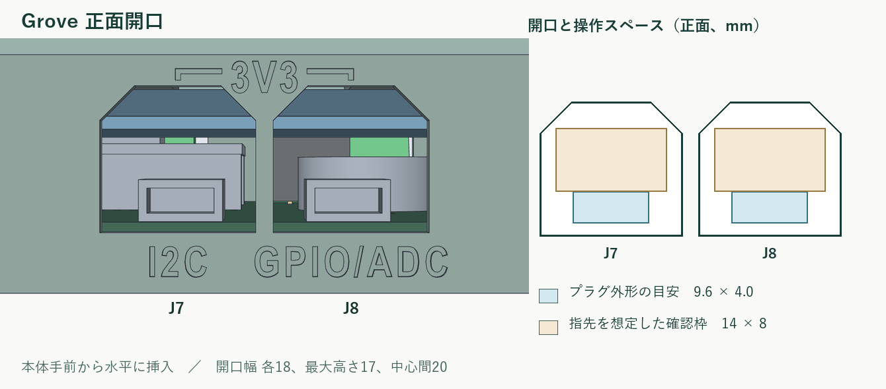

# Rev1 ケースの組み立て

100 × 100 mmのキャリア用。ケース本体の外形は121.1 × 110 × 30.4 mm。つまみ・ねじ頭・ゴム足は別。基板は四隅のボスに、ふたは基板の外側にある4本のM3熱圧入インサートに固定する。

[ケース3D（GitHubブラウザー表示）](../3d-models/Case_Browser.stl) · [底・蓋の組立STEP](../3d-models/Wave-Logger-Case.step) · [実装基板と液晶支持部品を含む組立STEP](../3d-models/Wave-Logger-Assembly.step) · [編集用SolidCraftモデル](../3d-models/Wave-Logger-Case.sc) · [底の印刷STL](../print/Wave-Logger-Tray.stl) · [蓋の印刷STL](../print/Wave-Logger-Lid.stl)

背面から端子を正面に見ると、左から丸形電源ジャックJ4、絶縁CAN端子台J6、RS-422/485端子台J1が並ぶ。それぞれの差込口の下に `DC 12V`、`ISO CAN`、`RS-422/485` を刻印した。電源ジャックの極性記号は中央の点が＋、外筒が−を示す。

| 背面から見た端子台 | 電線差込口を左から右へ（5番 → 1番） |
| --- | --- |
| J6・絶縁CAN | V+、CAN_H、SHIELD（基板内は未接続）、CAN_L、V− |
| J1・RS-422/485 | GND、CH2−、CH2+、CH1−、CH1+ |

ケース背面に刻印しているのは端子台の名称です。各穴に対応する信号名は[背面の端子配置図](../../docs/wiring/Rear-Terminals.png)で照合できます。端子台本体に表示する場合は、[信号名の原寸ラベル](../../docs/wiring/Terminal-Markers.pdf)を無通電で傾斜面に仮置きし、ねじ・電線を避けて読み取れる位置を実物で確認してください。

## ふたの固定と通気

| 箇所 | 公称寸法 |
| --- | --- |
| トレー外側の丸いボス（4か所） | 外径φ10.3 mm、熱圧入用下穴φ4.1 mm × 深さ4.5 mm、最小肉厚3.10 mm |
| ふたのねじ穴（4か所） | M3の通し穴φ3.4 mm、ねじ頭用座ぐりφ6.4 mm × 深さ0.8 mm。座ぐり底の板厚2.0 mm、外周までの最小肉厚1.95 mm |
| ふたの位置決め | 内側4辺に高さ2.0 mmのガイド。左のガイドはトレーの切り欠きに入り、ふたを180°回すと着座しない。ガイドと受けのすきまは公称0.4 mm |
| 本体電源PS1の直上 | 25 × 2.8 mmの通気スリット4本 |
| 絶縁CAN電源PS2の直上 | 20 × 2.8 mmの通気スリット2本 |

設計基準のインサートはウェーブビット WB-304540（M3 × 0.5、長さ4.0 mm、外径4.5 mm）4個。ボスの径方向の肉厚は下穴から3.10 mm、インサート外径から2.90 mm。ボスと基板の左右端には公称0.25 mmのすきまがある。圧入後の保持力は試作で確認する。[ウェーブビットの寸法と熱圧入方法](https://www.tokai-mmc.co.jp/insert/seihin_wb.html)

PS1・PS2の温度は、ふたを閉め、液晶点灯・microSD記録・CAN動作時に試作機で測定する。[ROHM BP5293-50 データシート](https://akizukidenshi.com/goodsaffix/BP5293_DataSheet_J_VerC_161013.pdf#page=14)

## ふたの WeAct スイッチ穴と LED 窓

R・B・Kの穴はφ2.5 mmで、隣り合う穴の間に最小1.06 mmの肉を残した。先端径2 mm以下の樹脂棒で真上から押す。L・Pはφ3.0 mmの窓から真上付近で確認する。各刻印の深さは0.60 mm。穴の中心はWeAct V1.1の外形資料から割り出した公称値。[ケース上面図](WeAct-Lid.png)・[WeAct公式ハードウェア資料](https://github.com/WeActStudio/WeActStudio.STM32H5_64Pin_CoreBoard/tree/master/Hardware)

| 刻印 | 対応する部品 | 穴の中心 x, y（mm） |
| --- | --- | --- |
| R | リセット（NRST） | 38.29, 38.93 |
| B | ブート（BOOT0） | 38.31, 42.49 |
| K | ユーザースイッチ（PC13） | 38.31, 46.06 |
| L | ユーザーLED（青、PB2） | 16.74, 29.30 |
| P | 電源LED（赤） | 13.35, 43.77 |

座標はキャリア基板を上から見て奥左が原点、右が x、手前が y。ふたのmicroSD開口は22 × 26 mm（x = 42～64、y = 23.5～49.5 mm）。WeAct基板の右端（x = 41.60 mm）のすぐ外に開口を置き、カードを右に抜く向きを維持した。実物でのカードの抜き差し、スイッチの操作性、LEDの見え方は試作時に確認する。

## 底面からの操作

奥の端子台を上にしてケースの底を見ると、左にCAN用のSW2、右にRS-422/485用のSW1がある。底面にスイッチ番号、CH、CAN、ON方向を深さ0.4 mmで刻印した。文字高設定は3.2 mm、`CAN` は4.2 mm。0.20 mm積層のスライスで、造形プレートに接する初層から隣の文字が分かれ、`A` の内側とON方向の矢印も残ることを確認した。全スイッチのON方向は端子台から液晶側。先の細い樹脂製の工具で切り替える。

| スイッチ | 基板の表から見た中心 (x, y) mm | 底板の操作窓 | 底から見た用途 |
| --- | --- | --- | --- |
| SW1・KHS42E | (6.50, 11.75) | 7.1 × 4.8 mm | 左の2個がCH2、右の2個がCH1。使うチャネルの2個を一緒にONにする。 |
| SW2・KHS22E | (75.00, 6.20) | 4.6 × 4.8 mm | 右の1番がCANの121 Ω終端。左の2番は未使用。 |

母基板の裏面は底外面から6.5 mm。KiCadから出力した実装モデルで、底外面から操作面までは両方とも4.215 mm。窓の前後端はスイッチ中心から各2.4 mmで、はんだランドの内縁から0.775 mm離れる。[OTAX KHS寸法図](https://akizukidenshi.com/goodsaffix/KHS.pdf#page=2)

## 液晶とエンコーダーの支持

液晶を挿す前に、表面の300 Ω（R40・R41・R43・R44）と240 Ω（R39・R42・R63・R64）を基板に沿って横置きする。裏面に出たリードは、はんだ付け後に基板下面から1.0 mm以内に切る。[表面の部品配置](../../docs/PCB-front.png)

CAD上の液晶基板下面は母基板表面から11.04 mm。抵抗を密着させたとき、最大胴径2.6 mmの300 Ωは8.44 mm、最大胴径2.1 mmの240 Ωは8.94 mmの隙間を取れる。リードを上記の長さに仕上げると、8本とも底板内面まで3.50 mm以上ある。

液晶の左端は12ピンソケットで受ける。EC11とK0を押したときの荷重は、右側2穴（基板座標 x = 92.35、y = 59.45・96.85 mm）に入れるM3ナイロンスペーサーで受ける。左奥のLCD用穴のすぐ横には裏面のR26とD7のランドがあるため、ここにはナットを付けない。

| 固定部 | 使用部品と合わせ方 |
| --- | --- |
| 液晶右側2か所 | 基板間11.04 mmに対し、スペーサーTP-10.8と液晶側の絶縁シム0.24 mmが公称の組み合わせ。ソケットを自然に挿した実物の高さにシムを合わせる。[TP-10.8寸法](https://akizukidenshi.com/catalog/g/g107561/) |
| スペーサーの固定 | 母基板裏はM3薄形ナット（厚さ1.8 mm、対辺5.5 mm）。液晶側はM3 × 5、頭径5.8 mm以下・頭高2.4 mm以下 |
| トレーの支柱 | 右奥スペーサーの下にφ9.6 mmの支柱。支柱上端は母基板下面から0.15 mm下。φ7.4 mmのくぼみでナットの角に0.52 mm以上、スペーサーのねじ先に0.75 mmのすきまを取る。右手前は既存のキャリア固定ボスの近くにある |
| 液晶窓の内壁 | 枠の下端は61.5 × 42.5 mm、上面は66.7 × 47.7 mm。ふたの下面から4.0 mmの枠を上方に広げ、ピンヘッダーや基板端を隠す。モデルの表示器外形60 × 41 mmに対して各辺0.75 mmの余裕があり、各辺に直交する方向へ真上から27°傾けても表示器の端が窓を通して見える計算。実機での見え方は液晶の版と取付位置で確認する |

## 印刷と組み立て

1. トレーとふたのSTLは、それぞれの外面を下にしてある。スライサーで単位mm、倍率100 %のまま印刷する。正面のGrove窓の上辺には10 mmの水平な橋渡しがある。底の4つの座はφ10.4 mm・深さ0.60 mmで、座の上には1.40 mmの底板が残る。卓上で使う場合は、厚さ0.60 mmを超えるφ10 mmの粘着ゴム足を貼る。
2. 基板を入れる前に、トレー外側4か所に選定したM3インサートを上端と面一まで熱圧入する。基板固定用4か所のφ2.5 mm・深さ5.35 mmの下穴にはM3のねじを切る。
3. 母基板の右側2穴に液晶用スペーサーを取り付け、薄形ナットを裏から固定する。次に母基板をトレーに載せ、頭径5.5 mm以下のM3 × 6ねじ4本で固定する。基板厚1.6 mmを通ったねじ先は下穴に4.4 mm入り、底まで0.95 mm残る。
4. 液晶をソケットに挿して水平を確かめ、右側2か所をシムとM3 × 5ねじで軽く固定する。ふた左側のガイドをトレーの切り欠きに合わせ、ねじを入れる前にふたが着座することを確認する。
5. ふたはM3 × 6ねじ4本で留める。座面の下に2.0 mmの樹脂があり、ねじ先はインサート側に4.0 mm入って下穴の底まで0.5 mm残る。各端子、端子台のねじ、microSD、液晶、EC11、K0およびWeActの3個のスイッチにはふたを閉じたままアクセスできる設計。

### ABSでの刻印と色入れ

Bambu Studio 2.7.1.62のX1 Carbon、Generic ABS、0.4 mmノズル、積層0.20 mm、サポートなしで印刷データを生成した。トレー138層・ふた34層で、スライサーの警告は0件。R・B・K間の2本の桟には、天板を構成する14層すべてで各2本の外周押出経路がある。

前後の端子表示は深さ0.60 mm。刻印の図の濃淡は公称外周線幅0.42 mmから推定した溝を示す。実物の陰影はケースの色と照明で変わる。[前面・背面・底面の刻印とスライス結果](ABS-Port-Markings.png)

濃色のABSに色を入れる場合は、組み立て前に細筆でつや消し白の水性模型塗料を溝に少量ずつ置く。はみ出しは乾く前に、水で軽く湿らせた綿棒の先で取る。電源だけ色分けする場合は、`DC 12V` と極性記号を同じ黄色にする。[ABS向け塗料の例と筆塗り方法](https://www.mr-hobby.com/ja/products/detail/110)

## Groveの抜き差し

ケースを正面から見ると、左の `I2C` がJ7、右の `GPIO/ADC` がJ8。窓の上の `3V3` は両口共通の電源電圧を示す。ケーブルを水平に挿す。正面壁の外側からコネクタの挿入口までの距離は5.0 mm。窓の下端はケース底外面から7 mm、幅は各18 mm、最大高さ17 mm。上隅を45°に絞り、上端の水平部は10 mm、2つの窓の間の桟は2 mmとした。

| 確認した操作 | CADで確認できた範囲 |
|---|---|
| 水平に挿す・抜く | Seeedのバックル付きケーブル110990038の公称断面9.6 × 4 mmを基準に、ケース外側から各挿入口までの直線経路を確認した。左右の隙間は各4.2 mm。[ケーブルの寸法](https://www.seeedstudio.com/Grove-Universal-4-Pin-Buckled-50cm-Cable-5-PCs-Pack.html) |
| 外側からラッチを押す | 幅14 × 厚さ8 mmの指先を仮定し、プラグの上に沿って挿入口の面まで届くことを確認した。隣のプラグを装着した状態の横方向の余裕は8.2 mm。ラッチの押点・必要な押し込み量はメーカーのケーブル寸法欄に記載がなく、指だけで解除できる範囲は実物未確認。 |
| 挿入口より奥にあるラッチに届く範囲 | 基板側コネクタ上面から液晶基板下面までの公称隙間は両方とも6.04 mm。幅4 × 厚さ2.5 mmの平たい樹脂工具を想定した空間は、挿入口より5 mm奥まで確保できる。造形・実装・部品公差を含む実測値は未確認。[コネクタ寸法図](https://akizukidenshi.com/goodsaffix/110990037-Model.pdf) |

## CADの基準

基板の表から見て左奥を (0, 0) とし、xは右、yは手前。組立STEPでは X = x、Y = 100 − y。STEPのZは底外面を0とし、底板の内面が2.0 mm、基板裏面が6.5 mm、基板表面が8.1 mm、蓋下面が27.6 mm。印刷STLは各部品が造形面に載るよう原点を移している。

Grove窓の中心は基板座標 x = 35、55 mm。KiCadの部品外形モデルではJ7・J8の挿入口が y = 100.00 mmにそろう。図のコネクタは干渉確認用の外形モデルで、嵌合内部や可動ラッチの形状は省略している。

### 裏面部品と試作で確認する箇所

R53・R54の直下のトレー上面は底外面から2.000 mm。両部品の0603モデルの最下面は5.965 mmで、公称すきまは各3.965 mm。両DIP窓、ゴム足の座、ふたの位置決め部、液晶下の支柱、スイッチの穴と液晶窓の四辺はSTL断面で照合した。ふた・トレーの印刷STLは各部品の全辺を2枚の三角形が共有する閉じたメッシュ。[現行基板の部品位置](../../docs/PCB-Rev1.md)・[トレーの印刷STL](../print/Wave-Logger-Tray.stl)

基板を含む組立STEPを再読込し、現行基板の117項目（部品モデルと基板本体）をトレー・ふたの双方と照合した。液晶右側の支持金具2組とトレー・ふたの組み合わせ、およびトレーとふたの組み合わせも含めた239組で、設計位置での体積干渉は0件。液晶のスペーサー、薄形ナット、シム、ねじは公称の外形で表し、基板および液晶モジュールとも干渉しないことを確認した。

試作では、使用する液晶の表示範囲、USB・DCプラグの根元までの挿入、ゴム足を貼った状態での安定性、インサートの保持力、ふたを閉じた連続動作時の温度を確認する。
